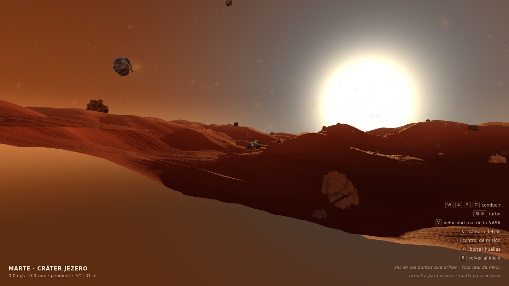
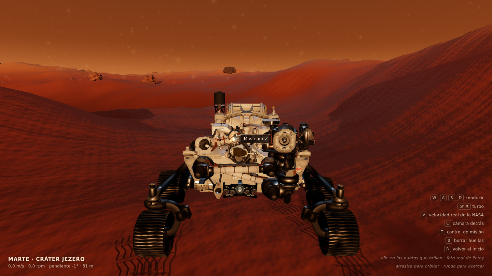
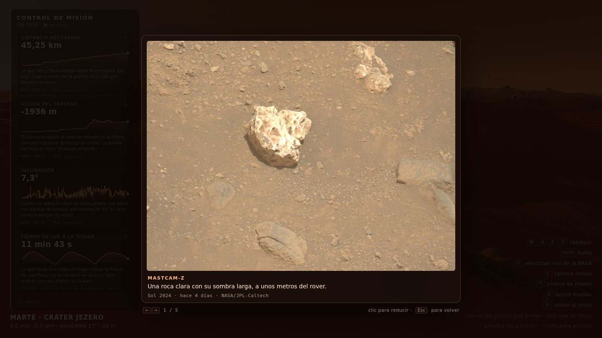
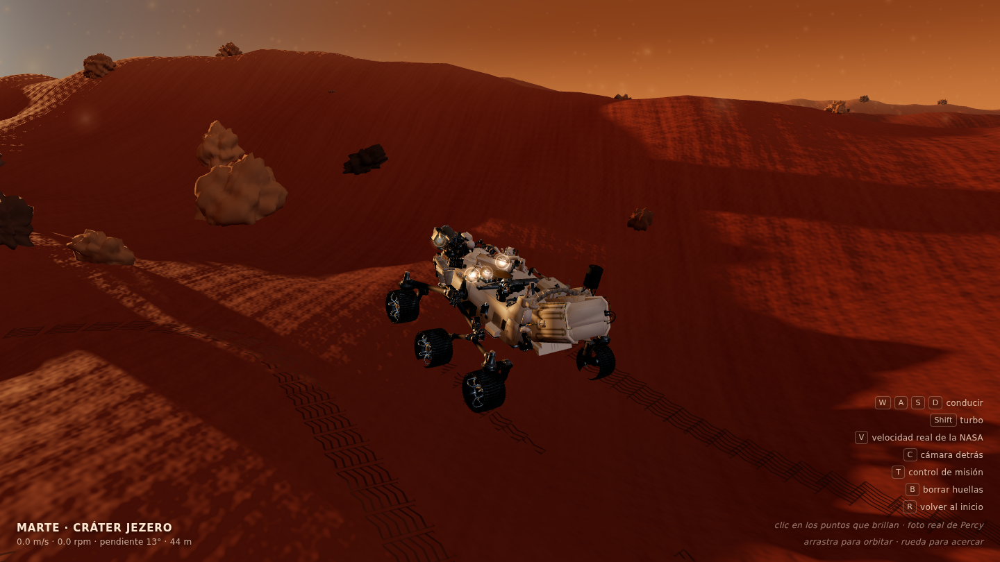
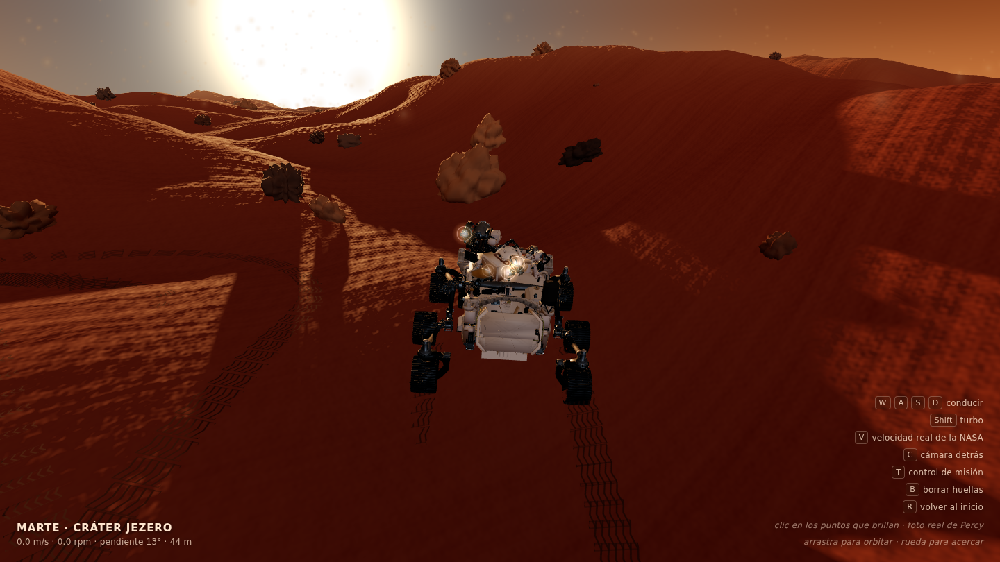
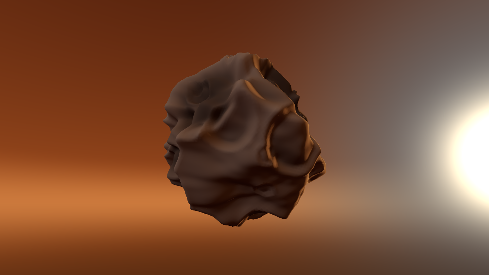
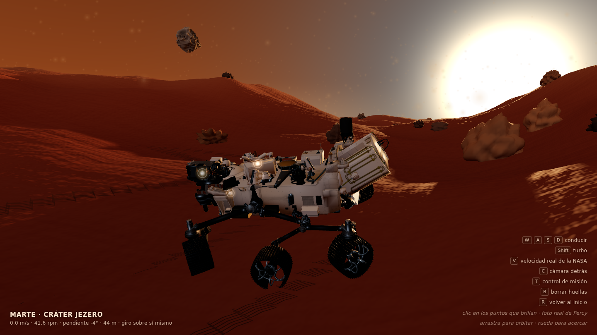

# 🔴 Perseverancia — Marte en el navegador

Un atardecer en el cráter Jezero, renderizado en tiempo real con **Three.js**, con el
rover **Perseverance** de la NASA conducible a escala real, sus seis ruedas girando
con la mecánica de verdad y sus cámaras abriendo fotos reales de Marte.



> Proyecto hecho como práctica del **Curso de Claude Code para Programadores** (Platzi).
> Toda la escena es procedural: no hay texturas descargadas ni mapas de altura externos.
> Lo único que se descarga es el modelo 3D oficial del rover y las fotos de la NASA.

---

## Qué tiene

- **Terreno procedural** de 700 × 700 m con dunas, generado con simplex noise y fBm
  escritos a mano, sin dependencias.
- **Cielo con shader propio**: caramelo polvoriento, banda de polvo en el horizonte y
  el halo azulado que el polvo fino de Marte produce alrededor del sol al atardecer.
- **Fobos y Deimos** modeladas con cráteres de perfil geológico real.
- **El rover Perseverance** de la NASA, a su tamaño real de 3 metros.
- **Las seis ruedas giran de verdad**, cada una a su velocidad, con suspensión
  rocker-bogie, dirección Ackermann y giro sobre sí mismo. El GLB de la NASA las trae
  fundidas en una sola malla: hay que separarlas en código.
- **Las cámaras de Percy abren fotos reales de Marte**: cuatro puntos que brillan sobre
  Mastcam-Z, las Navcam, las Hazcam delanteras y WATSON. Clic, obturador, y la foto se
  revela poco a poco.
- **Huellas de las ruedas** con el patrón de galones de los grousers reales.
- **Control de misión** con telemetría real de Percy: distancia recorrida, altura del
  terreno e inclinación del historial de manejos de la NASA, más el tiempo de luz
  Tierra–Marte calculado en vivo con elementos orbitales del JPL.
- **Verificación automática** con `npm run check`: abre la página en un Chrome
  headless, conduce el rover, hace clic con el ratón en una cámara, guarda las capturas
  y falla si hay errores de consola.

## Capturas

**Las cuatro cámaras**, brillando sobre sus piezas del modelo, con su nombre al pasar
el ratón:



**La foto abierta**: Mastcam-Z, sol 2024, bajada en vivo de la API de imágenes en bruto
de la NASA.



| El rover a escala real | El rastro de huellas |
|---|---|
|  |  |

**Fobos**, con su cráter dominante tipo Stickney:



## Cómo ejecutarlo

```bash
npm install
npm run dev          # http://localhost:5173
```

### Controles

| Tecla | Acción |
|---|---|
| `W` `A` `S` `D` o flechas | Conducir |
| `Shift` | Turbo |
| `V` | Velocidad real de la NASA (0.042 m/s) |
| `C` | Devolver la cámara detrás del rover |
| `T` | Mostrar u ocultar el control de misión |
| `B` | Borrar las huellas |
| `R` | Volver al punto de inicio |
| Clic en un punto que brilla | Abrir una foto real de esa cámara |
| `←` `→` | Más fotos de esa cámara |
| Clic en la foto | Ampliar o reducir |
| `Esc` | Volver al juego |
| Ratón | Arrastrar para orbitar, rueda para acercar |

### Verificación

```bash
npm run check
```

Abre la página en un Chromium headless (el que Playwright ya tenga en caché, **sin
descargar navegadores**) y comprueba de punta a punta:

- que la escena renderiza y no hay errores de consola;
- que los cuatro datos del control de misión trajeron números reales y que `T` los oculta;
- que **las seis ruedas giran**, que en curva las de fuera giran más que las de dentro,
  y que paradas y con `A` las cuatro esquinas se cruzan para girar sobre sí mismo;
- que **las cuatro cámaras abren una foto real**: hace clic con el ratón de verdad sobre
  cada punto, espera a que la imagen de `mars.nasa.gov` esté cargada y revelada, y
  comprueba que las flechas pasan de foto y que `Esc` cierra.

Deja `check/screenshot.png`, `check/foto-abierta.png` y `check/console.json`, y sale con
código ≠ 0 si algo falló. Útil para CI y para revisar un cambio sin abrir el navegador.

## Cómo está hecho

```
src/
  main.js       escena, luces, cámara y bucle de render
  noise.js      simplex noise 2D + fBm, sin dependencias
  terrain.js    campo de altura (dunas, erosión, rizos) y malla del terreno
  sky.js        shader de la cúpula del cielo
  textures.js   normal maps y mapas de rugosidad procedurales, sin costura
  rocks.js      rocas repartidas con InstancedMesh
  moons.js      Fobos y Deimos con cráteres
  dust.js       polvo en suspensión
  rover.js      carga del GLB, escala real y toda la física de movilidad
  wheels.js     parte la malla de las ruedas en seis y les monta los pivotes
  tracks.js     huellas de las ruedas
  camaras.js    los puntos que brillan sobre las piezas ópticas
  visor.js      obturador, revelado y visor de fotos
  fotos.js      las 19 fotos de la NASA elegidas a mano
  telemetry.js  mini TelemetryAPI con el patrón de proveedores de NASA Open MCT
  missionControl.js  el panel: valor, gráfica de toda la misión y qué significa
  providers/
    nasaWaypoints.js  historial real de manejos (NASA MMGIS)
    lightTime.js      distancia Tierra-Marte por elementos orbitales del JPL
scripts/
  check.mjs     verificación automática con Playwright
public/
  models/       el GLB del rover
  draco/        decodificador Draco servido en local
```

### Las ruedas venían fundidas en una sola malla

El GLB oficial de la NASA trae las seis ruedas en **un único nodo** (`Wheels_objs`,
34.788 vértices en 3 primitivas comprimidas con Draco) y **sin huesos**. No existía
ningún objeto que se pudiera rotar: por eso no giraban, y por eso no se arregla
buscando el nodo correcto.

La solución es partir la malla en código. Se calcula el centroide de cada triángulo,
se agrupan con **k-medias (k = 6)** en el plano x/z sembrando los centros en las seis
posiciones donde deben estar las ruedas, y con cada grupo se construye una
sub-geometría indexada nueva, remapeando los vértices. A cada rueda se le monta
después su propia jerarquía de pivotes:

```
base         → sube y baja: recorrido de la suspensión
 └ direccion   → gira sobre el eje vertical: solo las 4 de las esquinas
    └ giro       → rueda sobre el palier: las 6, cada una a su velocidad
       └ las mallas de esa rueda, con el origen puesto en el palier
```

Girando sobre sí mismo, las cuatro ruedas de las esquinas se cruzan en **X**:



Sobre esa jerarquía va la física de verdad:

- **Rocker-bogie con diferencial.** El terreno se muestrea bajo las seis ruedas. Cada
  lado da el ángulo de su rocker, y el cabeceo del chasis es **la media de los dos**,
  que es exactamente lo que hace el diferencial transversal real. El balanceo sale de
  la diferencia de apoyo entre lados.
- **Ackermann.** El ángulo de cada rueda directriz es `δ = atan2(ψ̇·z, v − ψ̇·x)`: la
  dirección que hace que esa rueda apunte adonde realmente se mueve. La misma fórmula,
  con `v = 0`, produce sola la **X** del giro sobre sí mismo.
- **Tracción.** `aMax = μ·g·cos(pendiente)` con μ = 0.55 y g = 3.721 m/s². Sale un
  límite de trepada de ~33°, cerca de los **30° certificados** por la NASA. Por encima,
  las ruedas patinan y el HUD lo dice.

### Las cámaras y las fotos

Los cuatro puntos son sprites aditivos sin test de profundidad, colocados sobre el
centro de `Mastcam_Z_cams`, `NavCams`, `hazcams_front` y `WATSON`.

Las 19 fotos vienen de la [API de imágenes en bruto de Mars 2020](https://mars.nasa.gov/rss/api/?feed=raw_images&category=mars2020&feedtype=json&ver=1.2&num=100&page=0&order=sol+desc),
filtrando por cámara con `&search=|NAVCAM_LEFT|`. Están **elegidas a mano**: se
descargaron las de los últimos soles, se montaron en hojas de contactos y se miraron
una a una. Se quedaron las que se sienten Marte — el horizonte de Jezero, el brazo
sobre el suelo, una roca a centímetros — y se descartaron el cielo vacío, el sol, los
blancos de calibración y las miniaturas. Cada foto dice su cámara, su sol y hace
cuántos días se tomó.

### Cinco detalles que costaron encontrarse

**1. `IcosahedronGeometry` no viene indexada.** Cada triángulo tiene sus propios
vértices, así que `computeVertexNormals()` produce *flat shading* por mucho detalle
que se le ponga. Las lunas y las rocas se veían facetadas hasta que pasaron por
`mergeVertices()` para soldar los vértices duplicados.

**2. Su parámetro `detail` no crece como `4ⁿ`,** sino que subdivide cada arista en
`detail + 1`, de modo que los vértices van como `(detail + 1)²`. Un `detail: 5` daba
362 vértices, no diez mil.

**3. Los normal maps procedurales tienen que repetir sin costura.** Se construyen como
suma de ondas con **frecuencias enteras** sobre el cuadro `[0,1)`: así son periódicos
por construcción y se pueden tilear sobre el terreno sin que se vea la junta.

**4. `Box3.setFromObject` no actualiza las matrices de los padres.** Llama a
`updateWorldMatrix(false, false)`, que actualiza *solo* la del propio objeto. Los
centros de las piezas ópticas salían calculados contra matrices viejas y los puntos
de cámara acababan flotando a 35 metros del rover. Se arregla con un
`updateMatrixWorld(true)` explícito desde la raíz antes de medir.

**5. Un overlay que se desvanece sigue comiéndose el ratón.** Tras pulsar `Esc`, el
visor tardaba 300 ms en irse por su transición de opacidad, y durante ese rato seguía
capturando los eventos del puntero: el clic en el siguiente punto no llegaba nunca.
`pointer-events: none` por defecto y `auto` solo en `.abierto`.

### Los datos de la NASA no se pueden pedir desde el navegador

El historial de manejos vive en `mars.nasa.gov` y **sí** manda `Access-Control-Allow-Origin: *`,
pero lo sirve con `Vary: Origin` detrás de CloudFront: la CDN entrega variantes cacheadas
**sin** esa cabecera y el `fetch` falla por CORS de forma intermitente. Un proxy que
reenvíe la petición tampoco funciona — con las cabeceras del navegador, CloudFront
responde 403.

La solución es un plugin de Vite de veinte líneas (`vite.config.js`): lo descarga Node y
lo sirve como propio, cacheado en memoria. Mismo dato, misma fuente, sin instalar nada.

### Decisiones conscientes

- **La velocidad no es real.** El Perseverance se mueve a 0.042 m/s (152 metros por
  hora). A esa velocidad esto sería injugable, así que conduce a 2.6 m/s. La tecla `V`
  la baja a la de verdad, para que se note lo lento que es Marte.
- **Las dunas tampoco.** Están a ~3 m de altura para que el rover pueda subirlas y
  guarden proporción con él.
- **Las lunas se ven más grandes** de lo que se verían desde la superficie de Marte.
  Licencia poética para que se aprecien los cráteres.
- **Los brazos de la suspensión no articulan.** En el GLB son una pieza rígida, así que
  el recorrido de cada rueda se limita a ±8,5 cm: lo justo para que se vea la suspensión
  trabajar sin que las ruedas se salgan del brazo.
- **El radio de rueda sale 0,2535 m** en vez de los 0,2625 m reales (3,4% corto), porque
  la escala del modelo está anclada a los 3,0 m de largo total y no a la rueda.
- **La odometría se corrige.** 129 de los 708 waypoints traen `dist_total_m = 0`: son
  marcas de «site increment, no motion», no lecturas reales. Se arrastra el máximo,
  porque un odómetro nunca retrocede.

## Créditos

- Modelo 3D del rover: [NASA 3D Resources](https://github.com/nasa/NASA-3D-Resources)
  — *Mars 2020 Perseverance Rover*.
- Fotos de Marte: **NASA/JPL-Caltech**, de la API pública de imágenes en bruto de
  Mars 2020 (dominio público).
- Telemetría: NASA MMGIS (historial de manejos) y elementos orbitales del JPL.
- Decodificador Draco: incluido en [three.js](https://github.com/mrdoob/three.js).
- Todo lo demás (terreno, cielo, lunas, rocas, polvo, huellas) es procedural.

## Tecnologías

Three.js · Vite · JavaScript (sin framework) · GLSL · Playwright
